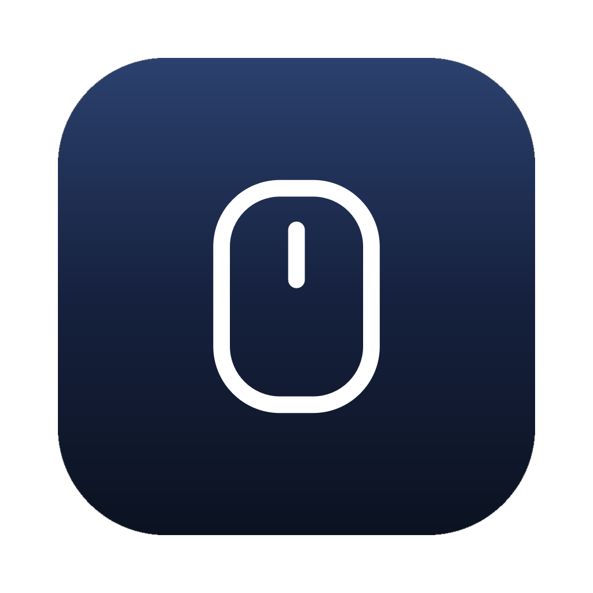

# Mouser · MX Master 4 体验优化

<p align="center">
  
</p>

围绕 **Logitech MX Master 4** 的日常使用体验持续改进：让按键响应更直接、震动反馈更自然，在多屏桌面和代码编辑器中用起来更顺手。

这是由 [Stewart222b](https://github.com/Stewart222b) 独立维护的项目，当前优先面向 **Windows + MX Master 4 蓝牙连接**。保留已有 Logitech HID++ 设备支持；其他型号、连接方式与操作系统需要分别验证。

项目源自 [TomBadash/Mouser](https://github.com/TomBadash/Mouser)，保留原作者的 MIT 许可证、版权声明。

## 已完成的体验改进

| 功能 | 使用效果 | 实机确认范围 |
| --- | --- | --- |
| Action Ring 跳转定义 | 实体键绑定到 **Ctrl + 左键点击**，光标放在代码符号上，短按并松开即可执行点击 | Windows、蓝牙、Cursor 中已确认跳转 |
| 前进／后退键震动 | 启用对应按键反馈后，按下即触发一次震动 | 两个侧键均已确认 |
| 中键立即震动 | 普通按键反馈立即发送，消除等待 HID 读取队列导致的延迟 | 已确认按下即震动 |
| 跨屏轻碰 | 光标进入另一块显示器时，触发一次轻碰波形 | 多屏切换和单下轻碰手感已确认 |
| 中文界面 | 补齐震动选项、鼠标动作、Actions Ring、DPI 档位与状态提示，支持即时切换简体／繁体中文 | 翻译覆盖与界面切换已自动检查 |
| 设置界面 | 文字导航、同屏按键编辑、紧凑设置行与 Actions Ring 四向预览，热点更清晰易点 | QML 交互、配置隔离及深浅色渲染已检查 |

表中按键与震动手感已在 MX Master 4 上实机确认；界面改动通过测试配置下的自动交互与渲染检查。自动检查覆盖输入、按键状态、震动触发条件、屏幕切换和更新流程；其他编辑器与设备的体验需要各自验证。

继续保留按应用映射、键盘快捷键、手势、滚轮方向、DPI、SmartShift 和设备能力检测等已有功能。支持程度以设备实际暴露的 HID++ 能力为准。

## 下载与运行

目前独立维护版本为 **3.8.5**，尚未发布正式 Release。可从 [Master4 Windows 构建](https://github.com/Stewart222b/Mouser/actions/workflows/custom-windows.yml) 中选择成功的 `main` 构建，下载 **Mouser-Master4-Windows** Artifact。

解压 Artifact 内的 `Mouser-Windows.zip`，保留整个 `Mouser/` 目录，运行 `Mouser.exe`。后续正式版本会发布到[本项目 Releases](https://github.com/Stewart222b/Mouser/releases)，程序内更新检查也只指向本仓库。

升级前退出正在运行的 Mouser。Logi Options+ 与 Mouser 同时控制同一设备可能冲突，应避免同时运行。

## 常用设置

**跳转定义：** 在「按键」中选择应用配置和 Action Ring 实体键，将「执行动作」设为 **Ctrl＋左键点击**。移动鼠标到函数或类型名上，短按并松开实体键。是否跳转由编辑器和语言服务决定。

Cursor 和 VS Code 可使用同一个输入动作；编辑器中的 coding agent 随宿主编辑器处理输入。普通聊天窗口或终端没有可用的定义目标时，不会因此获得跳转能力。

**按键震动：** 启用全局震动，并为需要反馈的按键打开震动开关。

**跨屏轻碰：** 在「震动反馈」中打开「跨屏震动」。默认关闭，使用当前全局强度，需要两块可切换的扩展桌面显示器。暂停 Mouser、关闭全局震动或断开设备时停止反馈。

Windows 配置位于 `%APPDATA%\Mouser\config.json`。安装包不包含个人配置；可选的通用 IDE 模板与配置脚本见 [CUSTOMIZATIONS.md](CUSTOMIZATIONS.md)。

## 项目方向

优先从 MX Master 4 的真实使用问题出发：

- 按键响应和组合输入是否准确，是否影响原生点击、拖拽和长按。
- 震动时机、波形和强度是否符合操作预期。
- 多屏、不同缩放比例、应用切换与蓝牙重连是否稳定。
- 在编辑器和日常桌面应用中的操作是否顺手。

改进先明确复现方式，再做针对性检查，并区分自动验证与实体鼠标试用结果。新体验按需提供开关，保留用户已有配置。其他设备的兼容修复欢迎提交，但不以扩大型号清单替代 Master 4 的体验打磨。

## 从源码运行与构建

Windows 使用 Python 3.12，Qt 固定为已验证的 PySide6 6.11.1：

```powershell
git clone https://github.com/Stewart222b/Mouser.git
cd Mouser
python -m venv .venv
.venv\Scripts\python.exe -m pip install -r requirements-master4.txt
.venv\Scripts\python.exe main_qml.py
```

相关检查与打包：

```powershell
.venv\Scripts\python.exe -m unittest tests.test_ctrl_left_click tests.test_ctrl_click_profiles tests.test_mouse_mapping_haptics tests.test_screen_haptics tests.test_engine tests.test_key_simulator tests.test_spec_coverage tests.test_updater tests.test_update_installer tests.test_locale_manager tests.test_localization
.venv\Scripts\python.exe -m PyInstaller Mouser.spec --noconfirm
```

输出位于 `dist/Mouser/`。架构与其他平台的历史实现说明见 [DEVELOPMENT.md](DEVELOPMENT.md)；功能细节与配置方法见 [CUSTOMIZATIONS.md](CUSTOMIZATIONS.md)。

## 反馈与维护

请在[本项目 Issues](https://github.com/Stewart222b/Mouser/issues) 中提供版本、系统、连接方式、复现步骤和预期手感。提交代码、截图、日志片段或配置示例前，请移除个人信息、敏感路径和凭据。

`main` 是独立开发主分支。仓库历史从一次完整源码导入开始，随后保留本项目的改进提交，不包含原项目的开发历史。版本、功能取舍和发布时间由本项目自行维护，不自动同步原项目。以后有需要时，仍可按提交选择性引入原项目的修复。

## 许可与致谢

使用 [MIT License](LICENSE)，完整的社区贡献说明见 [ACKNOWLEDGMENTS.md](ACKNOWLEDGMENTS.md)。

本项目与 Logitech 无隶属或背书关系。Logitech、MX Master 和 Options+ 为其各自权利人的商标。
